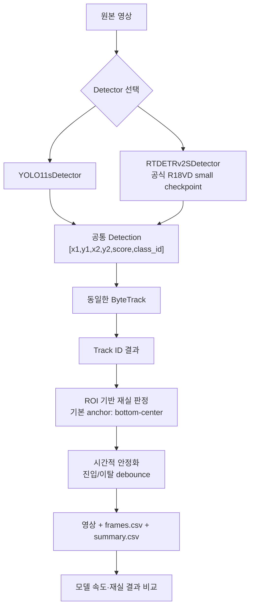

260825 현재 업데이트 : GT_Class

# 열화상 재실자 탐지 모델 비교

`YOLO11s + ByteTrack`와 `RT-DETRv2-S + ByteTrack`를 같은 영상, 같은
사람 클래스 임계값, 같은 공통 detection 형식, 같은 ByteTrack 설정으로
비교하는 연구용 파이프라인입니다.

기존 `sample.py`의 프레임 순차 처리 방식은 유지하면서 Detector, Tracker,
Occupancy counter, Output/Evaluation을 분리했습니다. 기존 결과처럼 매
프레임의 검출 수를 바로 사람 수로 사용하지 않고, Track ID와 ROI 및 시간적
안정화를 거친 값을 재실 인원으로 저장합니다.

## 파이프라인



`RT-DETRv2-S`는 Hugging Face Transformers에서 제공하는 공식 소형
R18VD 체크포인트 `PekingU/rtdetr_v2_r18vd`를 사용합니다. 두 Detector는
COCO `person` 클래스 ID 0만 공통 `Nx6` 배열로 반환합니다.

## 프로젝트 구조

```text
.
├─ configs/
│  └─ sample.yaml
├─ data/raw/                     # 선택: 원본 영상 보관
├─ docs/
│  └─ sample_code_review.md
├─ outputs/
├─ src/thermal_occupancy/
│  ├─ detectors/                 # 1. Detector
│  │  ├─ base.py
│  │  ├─ yolo11.py
│  │  └─ rtdetr_v2.py
│  ├─ trackers/                  # 2. Tracker
│  │  └─ byte_track.py
│  ├─ occupancy/                 # 3. Occupancy counter
│  │  ├─ roi.py
│  │  ├─ temporal.py
│  │  └─ counter.py
│  ├─ output/                    # 4-a. Output
│  ├─ evaluation/                # 4-b. Evaluation
│  ├─ pipeline.py
│  └─ cli.py
└─ tests/
```

## 설치

PowerShell에서 다음을 실행합니다.

```powershell
python -m venv .venv
.\.venv\Scripts\Activate.ps1
python -m pip install --upgrade pip
python -m pip install -e ".[dev]"
```

GPU를 사용할 경우에는 먼저 사용 중인 CUDA 버전에 맞는 PyTorch를 공식
설치 명령으로 설치한 뒤 위 명령을 실행하십시오. 모델 설정과 다운로드
파일은 기본적으로 프로젝트의 `.cache/` 아래에 저장됩니다.

## 실행

첨부된 원본 영상 경로는 이미
[`configs/sample.yaml`](configs/sample.yaml)에 설정되어 있습니다.

먼저 영상 정보와 설치 상태를 확인합니다.

```powershell
.\.venv\Scripts\python.exe -m thermal_occupancy inspect `
  --input "C:\Users\w0102\OneDrive\바탕 화면\cctv 샘플영상\원본.mp4"

.\.venv\Scripts\python.exe -m pytest
```

두 모델의 짧은 스모크 테스트:

```powershell
.\.venv\Scripts\python.exe -m thermal_occupancy compare `
  --config configs\sample.yaml `
  --max-frames 25
```

전체 영상 비교:

```powershell
.\.venv\Scripts\python.exe -m thermal_occupancy compare `
  --config configs\sample.yaml
```

하나의 모델만 실행할 수도 있습니다.

```powershell
.\.venv\Scripts\python.exe -m thermal_occupancy run `
  --config configs\sample.yaml `
  --detector yolo11s
```

`configs/sample.yaml`의 `device`는 기본 `auto`입니다. GPU를 명시하려면
`device: 0`, CPU만 사용하려면 `device: cpu`로 바꿉니다.

## ROI 설정

현재 ROI는 좌표가 제공되지 않아 전체 화면으로 설정되어 있습니다.
실제 재실 측정 영역을 영상 폭·높이에 대한 0~1 정규화 좌표로 교체해야
합니다.

```yaml
occupancy:
  roi:
    polygon:
      - [0.12, 0.25]
      - [0.91, 0.25]
      - [0.98, 0.95]
      - [0.05, 0.95]
    anchor: bottom_center
```

`bottom_center`는 사람 bounding box의 발 위치에 가까운 점을 사용하므로
ROI 경계에서 box 중심보다 해석이 자연스럽습니다. 진입 및 이탈 안정화
시간은 `enter_confirm_sec`, `exit_confirm_sec`에서 FPS와 독립적으로
설정합니다.

## 출력

각 비교 실행은 `outputs/원본_YYYYMMDD_HHMMSS_.../` 아래에 저장됩니다.

```text
run/
├─ yolo11s/
│  ├─ annotated.mp4
│  ├─ frames.csv
│  └─ summary.csv
├─ rtdetrv2_s/
│  ├─ annotated.mp4
│  ├─ frames.csv
│  └─ summary.csv
├─ comparison/
│  ├─ model_summary.csv
│  ├─ agreement.csv
│  └─ comparison_report.md
└─ manifest.json
```

`frames.csv`는 프레임 번호·시간·검출 수·Track ID·ROI 원시 인원·안정화
재실 인원·추론 시간을 기록합니다. `summary.csv`에는 평균/P50/P95 추론
시간, end-to-end FPS, 고유 Track ID 수, 평균/최대 재실 인원 등이
포함됩니다. 속도 측정 전에는 두 Detector 모두 기본 3회의 warm-up 추론을
실행하며, 이 시간은 프레임별 추론 통계와 end-to-end FPS에서 제외됩니다.

`agreement.csv`의 count MAE, 정확 일치율, 재실/비재실 일치율은 두
모델끼리의 차이일 뿐 정확도가 아닙니다. 정확도 비교를 논문에 보고하려면
열화상 프레임 및 Track ID 정답을 별도로 라벨링하여 precision, recall,
mAP, HOTA, IDF1 또는 MOTA를 계산해야 합니다.

## 열화상 연구 시 주의점

- 현재 두 체크포인트는 COCO 가시광 영상으로 사전학습된 baseline입니다.
  실제 열화상 성능 결론에는 동일한 열화상 학습/검증 split으로 각 모델을
  fine-tuning해야 합니다.
- 비교 시 입력 영상, ROI, confidence, ByteTrack 설정, 시간 안정화 설정을
  고정하십시오.
- 전체 영상은 약 53,972프레임이므로 CPU 실행에는 긴 시간이 필요합니다.
  논문용 속도 비교는 같은 GPU, 같은 warm-up 조건에서 반복 측정하십시오.
- ByteTrack은 Re-ID 모델이 아니므로 사람이 화면을 완전히 나갔다가
  돌아오면 새 ID가 부여될 수 있습니다.
=======
# OccupantDetection
>>>>>>> 0134e3431a9163b8c1a528aadd069f62a082044e
